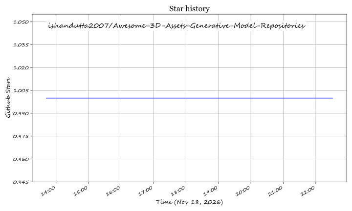

# 🌐 Awesome 3D Assets & Generative Model Repositories

  

  
  
  
  
  
  
  

---

## 🧭 Overview & Ecosystem Highlights

A comprehensive, SEO-optimized curated directory tracking top **commercial SaaS platforms**, **3D digital asset marketplaces**, and **open-source GitHub generative AI repositories**. Whether you are building production game pipelines in Unreal Engine or Unity, generating textured 3D meshes using diffusion transformers (DiT), or self-hosting open CC0 3D models and millions of CAD/radiance field assets, this list indexes the essential tools across the 3D ecosystem.

* **Asset Categories**: 3D meshes (`.glb`, `.gltf`, `.fbx`, `.obj`, `.usdz`), PBR materials, HDRI lighting environments, photogrammetry scans, and CAD parts.
* **Generative AI Methods**: Text-to-3D, Image-to-3D, 3D Gaussian Splatting (3DGS), Neural Radiance Fields (NeRF), Multi-View Diffusion, Flow Matching, and automated UV/retopology engines.
* **Integrations**: Blender plugins, Model Context Protocol (MCP) servers, PyTorch frameworks, and WebGL/Three.js viewers.

---

## 📑 Table of Contents
- [📊 Sector Overview & Market Dynamics](#-sector-overview--market-dynamics)
- [💼 SaaS & Commercial Hosted Platforms](#-saas--commercial-hosted-platforms)
- [🚀 Open-Source GitHub Repositories](#-open-source-github-repositories)
- [🤝 How to Contribute](#-how-to-contribute)
- [💖 Support](#-support)
- [⚖️ Disclaimer & Licensing](#️-disclaimer--licensing)
- [⭐ Star History](#-star-history)

---

## 📊 Sector Overview & Market Dynamics

The global 3D digital asset and 3D generative AI market is estimated at approximately **$12.4 billion to $15 billion** (with the dedicated 3D generative AI sub-segment growing at an aggressive CAGR of >35%, projected to exceed $6 billion by 2030). The market exhibits **moderate fragmentation with high concentration around core distribution nodes**: platform infrastructure and commerce are consolidated around game engine giants (Epic Games' Fab, Unity) and traditional stock libraries (Shutterstock's TurboSquid), whereas generative 3D modeling, neural synthesis (Gaussian splatting, DiTs), and specialized asset tooling remain highly fragmented across agile AI startups and fast-moving open-source research frameworks.

---

## 💼 SaaS & Commercial Hosted Platforms

The following table benchmarks leading hosted 3D asset marketplaces, cloud repositories, and proprietary generative 3D platforms. Companies are sorted in descending order by estimated corporate size (market capitalization, private valuation, or parent valuation).

| Company / Platform | Description | Size / Valuation (USD) | Pricing (Starting Tier) | Free Tier Limit |
| :--- | :--- | :--- | :--- | :--- |
| **[Unreal Engine Fab](https://fab.com)** | Epic Games' flagship digital content marketplace uniting Unreal Marketplace, Sketchfab Store, and Quixel assets. | **~$22.5B** *(Epic Games valuation)* | **$0 / Pay-Per-Asset** (e.g., assets from $4.99; 88/12 revenue split for sellers) | **Free forever standard account**: Unlimited downloads of community free 3D assets, curated monthly promotional Unreal packs, and access to select CC0/standard library models without subscription fees. |
| **[Unity Asset Store](https://unity.com)** | Premier digital storefront for game developers and real-time 3D creators with plugins, tools, and environments. | **~$18.6B** *(Unity NYSE: U market cap)* | **$0 / Pay-Per-Asset** (e.g., individual assets start from $4.99; Pro engine seats from $2,040/year) | **Free forever standard account**: Permanent access to browse and import 8,000+ free community 3D models, sample environments, and utility scripts directly into Unity projects. |
| **[TurboSquid](https://turbosquid.com)** | Established commercial 3D stock model catalog with StemCell-certified geometry and enterprise indemnification. | **~$110M** *(Parent Shutterstock NYSE: SSTK; $75M acquisition)* | **$0 / Pay-Per-Asset** (Assets starting from $9.00 up to $500+; Small Business license upgrade from $99) | **Free forever account**: Access to search and download over 100,000+ catalog items listed at $0; standard license capped at $10,000 legal indemnification per asset. |
| **[Sketchfab](https://sketchfab.com)** | Industry-standard web 3D model viewer, embeddable player, and marketplace hosting millions of 3D models. | **~$75M - $100M** *(Acquired by Epic Games; divested to KitBash)* | **$15/month** *(Pro plan billed annually, or $24/month billed monthly)* | **Free forever Basic plan**: Unlimited public model viewing; up to 10 downloadable uploads/month with a maximum file upload limit of 50 MB per model. |
| **[CGTrader](https://cgtrader.com)** | High-volume 3D model marketplace and enterprise product 3D visualization platform (Modelry). | **~$40M - $60M** *(Privately held, $12.4M venture funding)* | **$9.99/month** *(Essentials plan with 25 asset downloads or 25 AI generations/month)* | **Free forever account**: Direct access to thousands of community free 3D models and a one-time trial of **5 free AI text-to-3D generations** without credit card requirement. |
| **[ArtStation Marketplace](https://artstation.com)** | Dedicated digital artist marketplace for character base meshes, ZBrush brushes, KitBash packs, and textures. | **~$30M - $50M** *(Acquired by Epic Games; divested to KitBash)* | **$9.95/month** *(ArtStation Pro portfolio and marketplace plan)* | **Free forever account**: Download all $0 community free assets; sellers can list up to **5 free product variants** (under 50 MB total file size) on their store. |
| **[Poliigon](https://poliigon.com)** | Curated architectural and product rendering library with photorealistic PBR materials, models, and HDRIs. | **~$15M - $30M** *(Bootstrapped & profitable independent private studio)* | **$6/month** *(Starter credit plan delivering 100 monthly download credits)* | **Free forever account**: Permanent download access to 100+ free curated PBR textures, models, and HDRI lighting assets with personal and commercial project licenses. |
| **[Hum3D](https://hum3d.com)** | Specialized professional 3D vehicle, automotive, electronics, and custom modeling service library. | **~$5M - $10M** *(Privately held specialized digital studio)* | **$75.00** *(Starting single-model license cost for individual lightweight 3D assets)* | **No free-forever subscription**: Users can browse 360-degree interactive web previews of all 25,000+ models; promotional assets occasionally offered via 3D community design competitions. |

---

## 🚀 Open-Source GitHub Repositories

The following open-source projects provide cutting-edge 3D diffusion weights, Gaussian splatting renderers, neural reconstruction tools, and self-hosted model registries. Repositories are sorted in descending order by GitHub Stars_Count and feature live stargazer badges.

| Repository | GitHub_Stars | Description | Focus Area |
| :--- | :--- | :--- | :--- |
| **[graphdeco-inria/gaussian-splatting](https://github.com/graphdeco-inria/gaussian-splatting)** |  | Original reference codebase for real-time 3D radiance field rendering with 3D Gaussian Splatting (`3DGS`). | Neural Radiance & 3DGS |
| **[Tencent-Hunyuan/Hunyuan3D-2](https://github.com/Tencent-Hunyuan/Hunyuan3D-2)** |  | High-resolution 3D asset generation combining flow-based shape diffusion (`DiT`) with high-resolution PBR texture painting. | Text/Image-to-3D Synthesis |
| **[microsoft/TRELLIS](https://github.com/microsoft/TRELLIS)** |  | Foundation 3D generative model using Structured 3D Latents (SLAT) outputting radiance fields, 3D Gaussians, and textured meshes. | Foundation Generative 3D |
| **[isl-org/Open3D](https://github.com/isl-org/Open3D)** |  | Modern open-source library for 3D data processing, point clouds, mesh filtering, registration, and visualization in C++ and Python. | 3D Geometry Processing |
| **[openai/shap-e](https://github.com/openai/shap-e)** |  | Official OpenAI conditional 3D generative model generating implicit functions, textured meshes, and NeRFs from text/images. | Implicit 3D Generation |
| **[nerfstudio-project/nerfstudio](https://github.com/nerfstudio-project/nerfstudio)** |  | Modular PyTorch framework for training, visualizing, and exporting NeRFs, Splatfacto models, and neural 3D surfaces. | Neural Reconstruction & Pipeline |
| **[facebookresearch/pytorch3d](https://github.com/facebookresearch/pytorch3d)** |  | Meta AI's modular PyTorch library delivering efficient, reusable 3D operators, mesh batching, and differentiable rendering. | Differentiable 3D Rendering |
| **[ashawkey/stable-dreamfusion](https://github.com/ashawkey/stable-dreamfusion)** |  | Complete PyTorch implementation of text-to-3D and image-to-3D via Score Distillation Sampling (SDS) with Stable Diffusion. | Diffusion Distillation |
| **[VAST-AI-Research/TripoSR](https://github.com/VAST-AI-Research/TripoSR)** |  | Lightning-fast feedforward single-image 3D reconstruction model generating 3D meshes under 0.5s on consumer GPUs. | Ultra-Fast 3D Mesh Synthesis |
| **[threestudio-project/threestudio](https://github.com/threestudio-project/threestudio)** |  | Unified PyTorch framework integrating multi-view diffusion, DreamFusion, Magic3D, Zero123, and high-res mesh exporters. | Unified 3D Framework |
| **[xxlong0/Wonder3D](https://github.com/xxlong0/Wonder3D)** |  | Single-image-to-3D reconstruction system employing cross-domain diffusion to generate consistent normal maps and textured meshes. | Multi-View Mesh Extraction |
| **[TencentARC/InstantMesh](https://github.com/TencentARC/InstantMesh)** |  | Fast feed-forward framework synthesizing high-quality 3D meshes from a single image in ~10 seconds with sparse-view diffusion. | Rapid Feed-Forward Mesh AI |
| **[cvlab-columbia/zero123](https://github.com/cvlab-columbia/zero123)** |  | Zero-shot single image novel view synthesis model and 3D reconstruction foundational pipeline from Columbia CV Lab. | Novel View Synthesis |
| **[wgsxm/PartCrafter](https://github.com/wgsxm/PartCrafter)** |  | Structured 3D generative model capable of generating compositional, part-decomposed 3D meshes from single images. | Part-Based 3D Geometry |
| **[manyfold3d/manyfold](https://github.com/manyfold3d/manyfold)** |  | Self-hosted, open-source digital asset management web platform (`DAM`) for organizing, tagging, and previewing 3D models. | Self-Hosted 3D DAM |
| **[allenai/objaverse-xl](https://github.com/allenai/objaverse-xl)** |  | Enormous open-source dataset containing 10M+ annotated 3D objects curated across web archives for training 3D generative AI. | Million-Scale 3D Dataset |
| **[facebookresearch/meshrcnn](https://github.com/facebookresearch/meshrcnn)** |  | Deep learning framework detecting real-world objects in unconstrained 2D images and predicting full 3D triangle meshes. | 2D-to-3D Mesh Prediction |
| **[reyamira/models](https://github.com/reyamira/models)** |  | Fast open-source Rust TUI and CLI catalog for searching, filtering, and benchmarking 4,000+ AI models directly in terminal. | AI Model Discovery CLI |
| **[ToxSam/open-source-3D-assets](https://github.com/ToxSam/open-source-3D-assets)** |  | Open-source public registry featuring 990+ royalty-free CC0 `.glb` models, avatars, and props backed by a searchable JSON database. | CC0 Public Domain 3D Models |

---

## 🤝 How to Contribute

We welcome additions, fixes, and ecosystem updates from creators, AI researchers, and developers!

1. 🍴 **Fork** this repository.
2. 🌿 Create a new branch (`git checkout -b add/new-3d-model-repo`).
3. 📝 Add your tool, platform, or open-source repository following the table layout:
   * **SaaS**: Include product name, URL, brief description, estimated company valuation/size, starting price tier, and specific free tier limits.
   * **Open-Source**: Include GitHub repository link, Stars_Badge (`style=social&color=white` linking to `/stargazers`), description, and core focus area.
4. 🚀 Push your branch and open a Pull Request with a short explanation.

---

## 💖 Support

Thank you for exploring and utilizing the **Awesome 3D Assets & Generative Model Repositories** list! If this resource saved you time, empowered your game development workflow, or aided your generative AI research, please consider supporting the project:

* ⭐ **Star** this repository to help boost discoverability on GitHub.
* 🍴 **Fork and share** the project with technical artists, 3D modelers, and AI teams.
* ☕ **Buy a coffee & sponsor**: Support ongoing maintenance and curated updates directly via the [GitHub Sponsor Dashboard](https://github.com/sponsors/ishandutta2007).

---

## ⚖️ Disclaimer & Licensing

* This repository is community-curated for informational and research purposes.
* Commercial game developers and studio production pipelines should independently review licensing agreements (`CC0`, `CC-BY`, `MIT`, `Apache-2.0`, or custom commercial EULAs) before deploying assets or model weights into commercial games or commercial applications.

---

##  Star History

## ⭐ Star History

<a href="https://star-history.com/#ishandutta2007/Awesome-3D-Assets-Generative-Model-Repositories&Timeline" align="center">
  <picture>
    <source media="(prefers-color-scheme: dark)" srcset="assets/ishandutta2007_Awesome-3D-Assets-Generative-Model-Repositories_growth.svg">
    
  </picture>
</a>
